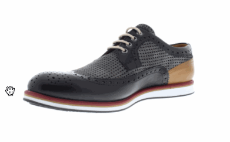

# 360° 产品图片序列预览组件

一个基于 HTML、CSS 和原生 JavaScript 的轻量级产品旋转查看器。通过连续播放同一产品的 36 张照片，模拟水平 360° 展示，无需 GLB、WebGL 或第三方框架。

## 效果预览



## 核心功能

- 36 张照片，每张对应 10°，循环展示产品
- 鼠标拖动、触屏滑动和键盘左右方向键
- 正面（第 1 帧）与背面（第 19 帧）快速切换
- 自动播放、暂停、上一帧、下一帧
- 展示当前角度、帧数和底部旋转进度细线
- 最大宽度 800px，响应式展示，图片完整显示
- 全部图片本地保存，可离线运行

## 快速开始

下载仓库后，用浏览器打开 `index.html` 即可体验。无需 npm、构建工具、数据库或服务器。

## 项目结构

```text
product-360-image-viewer/
├── index.html
├── css/
│   └── style.css
├── js/
│   └── viewer.js
├── images/
│   ├── img01.jpg
│   ├── ...
│   ├── img36.jpg
│   └── preview.gif
└── README.md
```

## 操作说明

| 操作 | 效果 |
| --- | --- |
| 拖动鼠标或触屏滑动 | 切换图片帧 |
| 360° 旋转 | 返回自由旋转模式 |
| 正面 / 背面 | 显示第 1 帧 / 第 19 帧 |
| 上一帧 / 下一帧 | 按 10° 切换 |
| 自动旋转 / 暂停旋转 | 控制连续播放 |
| 键盘 ← / → | 在旋转模式下切换帧 |

## 替换产品图片

拍摄同一产品的一整圈照片，推荐固定相机位置、背景、光线和产品中心。将 36 张照片按顺序命名为 `img01.jpg` 至 `img36.jpg`，替换 `images/` 下的演示文件。

图片数量与文件命名逻辑在 `js/viewer.js` 中定义。若使用 WebP，请统一修改照片格式及代码中的扩展名。正面和背面分别默认取索引 0 和 18；若拍摄起点不同，可根据实际产品调整。

## 技术原理和限制

本项目使用平面照片的图片序列切换，并不是真正的三维模型渲染。它可以沿拍摄的水平角度旋转，但不能任意俯仰、查看未拍摄的角度或改变材质与光照。

## 后续维护方向

优先保证轻量、可维护和易嵌入。未来可根据实际需要改进 WebP 图片优化、加载策略、参数配置与 WordPress 短代码或 Gutenberg 区块集成。

## 演示素材

36 张 JPG 演示照片取自 [ferrybrouwer/360-product-viewer](https://github.com/ferrybrouwer/360-product-viewer)；`preview.gif` 是本项目的动画预览。图片版权和再分发许可需要另行确认，商业使用前建议替换为自有或已获明确授权的素材。

---

**技术栈：** HTML5 · CSS3 · Vanilla JavaScript
